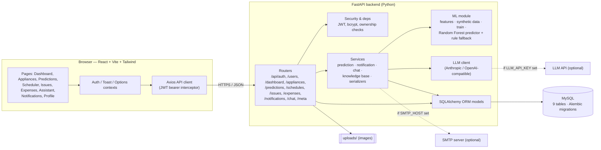
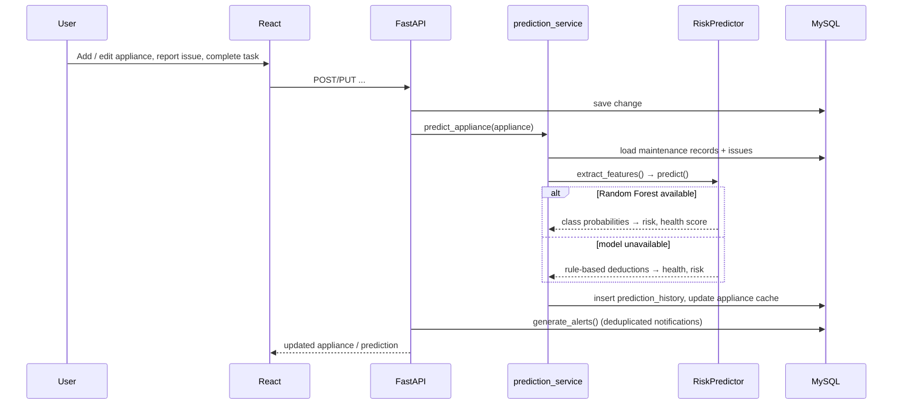

# Software Architecture

Smart Household Maintenance Manager – Predictive HomeCare AI is a three-tier web application:
a React single-page app, a FastAPI REST backend, and a MySQL database. The AI/ML components
(a Random Forest risk model, a rule-based fallback, and an LLM assistant with a rule-based fallback)
run inside the backend as services.

## High-level architecture

## Layers and responsibilities

| Layer | Folder | Responsibility |
|---|---|---|
| Presentation | `frontend/src/pages`, `components` | Screens, forms, charts (Recharts), dialogs, toasts, empty/loading states |
| Client state & API | `frontend/src/context`, `api` | Auth session (JWT in localStorage), dropdown options from `/api/meta/options`, Axios services |
| API / Controllers | `backend/app/routers` | HTTP endpoints, request validation (Pydantic), status codes |
| Security | `backend/app/core` | Settings, bcrypt hashing, JWT issue/verify, token revocation (`token_version`), per-user ownership checks |
| Business services | `backend/app/services` | Prediction orchestration, schedule suggestions, alert generation, chatbot, issue troubleshooting |
| AI / ML | `backend/app/ml` | Feature engineering, synthetic data, model training, inference + rule-based fallback |
| Persistence | `backend/app/models`, `app/db`, `alembic/` | ORM models, sessions, migrations |
| Utilities | `backend/app/utils` | Image upload validation, SMTP email, UTC time helpers |

## Key flows

### 1. Prediction flow

### 2. Issue reporting flow
Report → priority (P1–P4 from severity, bumped if the appliance is already High/Critical risk)
→ AI troubleshooting suggestions (LLM, else knowledge base) → re-run prediction → create alerts
→ return a recommended schedule the user can book with one click.

### 3. Completing a maintenance task
`PATCH /schedules/{id}/status {status: Completed}` creates a `maintenance_records` row, updates the
appliance's `last_service_date`, logs an `expenses` row for the cost, resolves open issues for repairs,
and re-runs the prediction, so the dashboard, history and expense reports stay consistent.

## Security design
* Passwords hashed with bcrypt; JWT (HS256) access tokens carry a `tv` (token version) claim.
  Logout, password change and password reset increment the user's `token_version`, revoking old tokens.
* Every query is filtered by `user_id`; foreign objects (appliance IDs passed in bodies) are checked with
  `get_owned_appliance`, and other users' records return **404** so their existence is not revealed.
* Password reset: random 256-bit token, only its SHA-256 hash is stored, 30-minute expiry, single use,
  identical response whether or not the email exists.
* Uploads: MIME whitelist, magic-byte check, size limit, random file names.

## Design decisions
* **Synthetic data, honestly labelled.** No real appliance-failure dataset exists for this project, so the
  model is trained on simulated data labelled by a noisy expert heuristic. The UI and API state this and
  describe scores as maintenance-priority estimates.
* **Explainability.** The transparent rule analysis is always computed; its factor list explains every
  prediction even when the Random Forest makes the risk decision.
* **Graceful degradation.** The app is fully usable with no LLM key, no SMTP server, and even without the
  ML model file (it retrains automatically, or falls back to rules).
