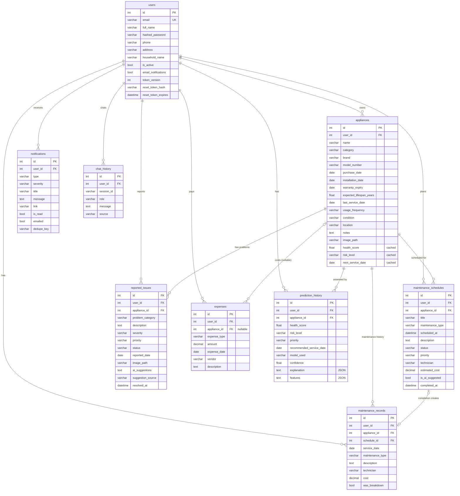

# Database Design

MySQL 8 / MariaDB 10.6+ (`utf8mb4`). Schema managed by **Alembic** (`backend/alembic/versions/0001_initial_schema.py`).
The full generated DDL is in [`schema.sql`](schema.sql).

Every table has an auto-increment primary key `id`, and `created_at` / `updated_at` timestamps (stored as UTC).

## ER diagram



## Tables

| Table | Purpose | Key relationships / rules |
|---|---|---|
| `users` | Accounts and profile | `email` unique; `token_version` revokes JWTs; reset token stored only as SHA-256 hash |
| `appliances` | Registered household appliances | FK `user_id` (CASCADE). Cached latest prediction (`health_score`, `risk_level`, `next_service_date`) for fast lists/dashboards |
| `maintenance_records` | Maintenance that actually happened (the history) | FK appliance (CASCADE); optional FK to the schedule that produced it (SET NULL) |
| `maintenance_schedules` | Planned tasks | Status: Pending, Scheduled, In Progress, Completed, Cancelled. `is_ai_suggested` marks tasks created from predictions |
| `reported_issues` | User-reported problems | Severity Low–Critical, priority P1–P4, AI suggestions text, status Open / In Progress / Resolved |
| `expenses` | Repair / servicing / replacement / parts costs | `appliance_id` nullable with ON DELETE SET NULL so spending history survives appliance deletion |
| `notifications` | In-app alert centre | Unique (`user_id`, `dedupe_key`) prevents duplicate alerts |
| `chat_history` | Assistant conversations | Grouped by `session_id`; `source` = llm or rules |
| `prediction_history` | Every assessment ever made | Explanation + factor list + class probabilities (JSON); feature snapshot for auditability |

## Indexes
| Index | Columns | Supports |
|---|---|---|
| `ix_users_email` (unique) | users.email | login |
| `ix_users_reset_token_hash` | users.reset_token_hash | password reset lookup |
| `ix_appliances_user_id`, `ix_appliances_user_category`, `ix_appliances_user_risk` | appliances | filtering lists by owner, category, risk |
| `ix_appliances_warranty_expiry` | appliances.warranty_expiry | warranty alerts |
| `ix_records_appliance_date` | maintenance_records(appliance_id, service_date) | history per appliance |
| `ix_schedules_user_status`, `ix_schedules_user_date` | maintenance_schedules | upcoming/overdue/completed views, calendar |
| `ix_issues_user_status` | reported_issues | open issues |
| `ix_expenses_user_date`, `ix_expenses_appliance_id` | expenses | monthly/yearly reports, per-appliance totals |
| `ix_notifications_user_read`, `uq_notifications_user_dedupe` | notifications | unread counts, de-duplication |
| `ix_chat_user_session` | chat_history | loading a conversation |
| `ix_predictions_appliance_created`, `ix_prediction_history_user_id` | prediction_history | latest prediction, trends |

## Migrations
```bash
cd backend
alembic upgrade head                                   # create / upgrade schema
alembic revision --autogenerate -m "describe change"   # after editing models
alembic downgrade -1                                   # roll back one step
```
